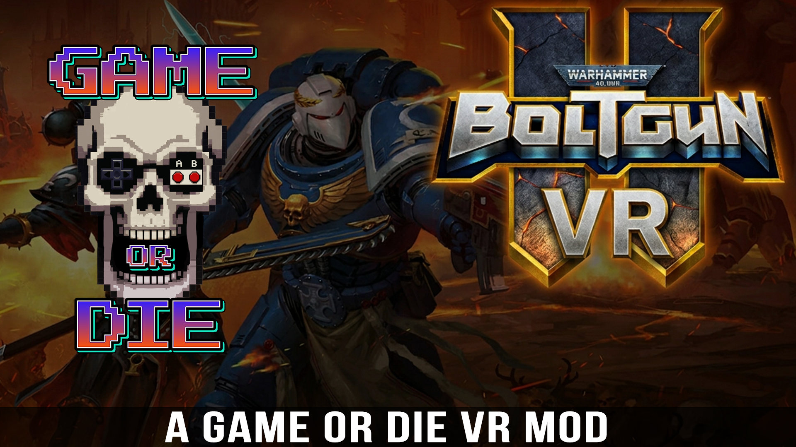

# Boltgun 2 VR

Boltgun 2 VR is a Game Or Die project that brings Warhammer 40,000: Boltgun 2 into PC VR, built on
[UEVR](https://github.com/praydog/UEVR) by praydog.

## Install

1. Download **`Boltgun 2 VR Installer.exe`** from the latest release and double click it. Windows
   may say "Windows protected your PC": click **More info**, then **Run anyway** (the installer is
   not code-signed).
2. Press **INSTALL**. It finds your copy of Boltgun 2, puts the VR files in a `VR` folder inside the
   game's folder, and downloads UEVR from its own release page.
3. Start Virtual Desktop or SteamVR, put your headset on, and press **PRESS START**.

Updating keeps your saves and settings.

**Installing by hand:** download `Boltgun-2-VR-1.0-PCVR.zip` from the latest release, unzip it,
and double click `Setup.bat`. Then start the game with the **Boltgun 2 VR** shortcut on your
desktop, or `Boltgun 2 VR.cmd` in the game's `VR` folder.

You need Warhammer 40,000: Boltgun 2 for PC (Steam), a PC VR headset with Virtual Desktop,
SteamVR or the Meta Quest Link app, and Windows 10 or 11.

## What it does

- Native stereo VR with head tracking, the game's own HUD on a panel in front of you.
- Every gun is a real 3D model in your right hand (the game's own models), with no pickup shine.
- Aim with the controller: shots leave the end of the barrel, and the muzzle flash, smoke and
  shell casings come out of the gun.
- The game's own crosshair sits where your shot will land and sizes itself to the distance.
- Recoil you can see, and the controller buzzes with every shot.
- A 3D chainsword in your left hand with a running chain. Hold the left trigger to rev it and
  swing. In the UEVR menu you can choose to show it only while you use it.
- Smoother in VR: UEVR renders at 80% resolution (UEVR menu, Resolution Scale). For more frames,
  set Global Illumination and Shadows to High in the game's graphics settings.

## Controls

The game's own controller layout, through UEVR:

| Button | Action |
|---|---|
| Right trigger | Fire |
| Left trigger | Chainsword (melee) |
| Right grip | Weapon wheel (pick with the right stick) |
| Left stick / right stick | Move / turn |
| A | Jump |
| X | Reload, use |
| Left grip | Ability skill |
| B | Mobility skill |
| Y | Taunt |
| Menu button | Pause |
| Both sticks pressed in | UEVR menu |

## Tested on

Played on a Meta Quest 3 and a Valve Steam Frame, each with its own controllers (OpenXR). Other
headsets and controllers should work through UEVR but have not been played yet.

## Known issues

- The game can crash as it quits. It does no harm (the same happens with other UEVR mods).

## Uninstall

Press **UNINSTALL** in the installer, or run `Uninstall.bat` in the game's `VR` folder. Your saves
and your UEVR settings for the game are kept. Something not working? Run `Collect logs.bat` there
and send us the zip it puts on your desktop.

## Credits

- **UEVR** by praydog, and **joeyhodge's** build of it, which runs Unreal Engine 5.7 games. Setup
  downloads it from [joeyhodge/UEVR](https://github.com/joeyhodge/UEVR/releases); it is not part
  of this download.
- **Chainsword model:** "Wh-40k-chainsword" by Kaiser-E
  ([Sketchfab](https://sketchfab.com/3d-models/wh-40k-chainsword-2976e3debf33494a831253b160f7d2c9)),
  under [CC BY 4.0](https://creativecommons.org/licenses/by/4.0/). Converted for this mod (turned,
  scaled, re-centred, the chain made to run).
- **Warhammer 40,000: Boltgun 2** by Auroch Digital, published by Focus Entertainment. Warhammer
  40,000 is a trademark of Games Workshop. This mod is not affiliated with or endorsed by them.

The mods are free, always. Videos of every game are at [gameordie.net](https://gameordie.net), and
I'm on [Patreon](https://www.patreon.com/GameOrDie).
